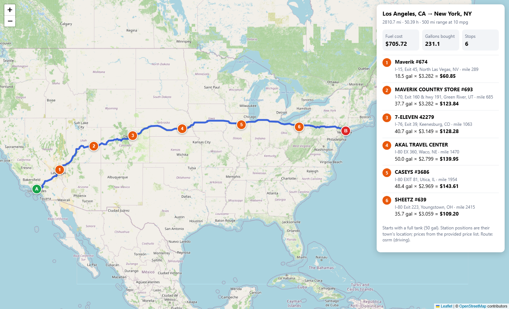

# Fuel Route API

A Django API that plans a road trip between two places in the USA and picks where to
buy fuel along the way, using the provided truck stop price list. The vehicle has a
500 mile range and does 10 miles per gallon. The response has the fuel stops, the
total spent on fuel, the route as GeoJSON, and a link to a map of the trip.



**One external call per request.** Station coordinates are computed ahead of time and
"City, ST" inputs are resolved offline, so a typical request makes exactly one call
to the routing API, and none at all when the same trip is asked for again.

---

## Quick start

Requirements: Python 3.12+ and [uv](https://docs.astral.sh/uv/).

```bash
uv sync
uv run python manage.py migrate      # creates the database and loads the 6,626 US stations
uv run python manage.py runserver
```

```bash
curl -X POST http://127.0.0.1:8000/api/v1/trip-plans \
  -H "Content-Type: application/json" \
  -d '{"start": "Denver, CO", "finish": "Chicago, IL"}'
```

Then open the `map_url` from the response in a browser. Interactive API docs are at
http://127.0.0.1:8000/api/docs, and a Postman collection is in
[`postman/`](postman/fuel-route-api.postman_collection.json).

No API key is needed. Routing uses the public [OSRM](https://project-osrm.org/) server
(car profile). With a free [OpenRouteService](https://openrouteservice.org/) key in
`.env` (`ORS_API_KEY=...`, see `.env.example`) it uses ORS's truck profile
(`driving-hgv`) instead.

---

## API

### `POST /api/v1/trip-plans`

| Field | Required | Description |
| --- | --- | --- |
| `start`, `finish` | yes | `"City, ST"`, `"City, State"`, `"lat,lon"` or a US street address |
| `corridor_miles` | no | How far off the route a station may be (default 10, 1–50) |
| `stop_cost` | no | Dollars each stop is worth avoiding (default 5, 0–100). `0` = lowest possible fuel bill |

Response `201` (abridged):

```json
{
  "id": "8ace2a78-2313-422f-a374-b9372326730c",
  "map_url": "http://127.0.0.1:8000/api/v1/trip-plans/8ace2a78-.../map",
  "start":  { "query": "Los Angeles, CA", "label": "Los Angeles, CA", "lat": 34.01939, "lon": -118.41083, "resolved_by": "places" },
  "finish": { "query": "New York, NY", "label": "New York, NY", "lat": 40.66271, "lon": -73.93868, "resolved_by": "places" },
  "route": {
    "distance_miles": 2810.7, "duration_hours": 50.39, "provider": "osrm", "profile": "driving",
    "geometry": { "type": "LineString", "coordinates": [[-118.41035, 34.01965], "..."] }
  },
  "vehicle": { "max_range_miles": 500.0, "mpg": 10.0, "tank_gallons": 50.0, "starts_with_full_tank": true },
  "fuel_stops": [
    {
      "stop": 1, "mile": 289.2, "off_route_miles": 2.0,
      "station": { "opis_id": 72965, "name": "Maverik #674", "address": "I-15, Exit 45",
                   "city": "North Las Vegas", "state": "NV" },
      "location": { "lat": 36.289865, "lon": -115.089181 },
      "price_per_gallon": 3.282, "gallons": 18.54, "cost": 60.85, "fuel_on_arrival_gallons": 21.08
    }
  ],
  "summary": {
    "total_fuel_cost": 705.72, "gallons_purchased": 231.07, "number_of_stops": 6,
    "average_price_per_gallon": 3.054, "trip_gallons": 281.07, "starting_tank_gallons_used": 50.0,
    "stations_within_corridor": 459, "corridor_miles": 10.0, "stop_cost": 5.0
  },
  "meta": {
    "external_api_calls": { "routing": 1, "geocoding": 0 },
    "route_from_cache": false,
    "timings_ms": { "locate_and_route": 2079.4, "planning": 217.9 }
  }
}
```

Errors are JSON `{"error": "<code>", "detail": ...}`:

| Status | `error` | When |
| --- | --- | --- |
| 400 | `invalid_request` | Missing or invalid fields |
| 404 | `place_not_found` | The start or finish could not be found |
| 422 | `outside_usa`, `same_place`, `no_route`, `no_fuel_in_range` | No valid plan exists |
| 502 | `routing_unavailable` | The routing provider failed or timed out |

### Other endpoints

| Endpoint | |
| --- | --- |
| `GET /api/v1/trip-plans/<id>` | A saved plan |
| `GET /api/v1/trip-plans/<id>/map` | The plan on an interactive map (Leaflet + OpenStreetMap) |
| `GET /api/docs`, `GET /api/schema` | Swagger UI and the OpenAPI schema |
| `GET /health` | Liveness check |

---

## How it works

```
"Denver, CO" ─┐                                ┌─ stations within 10 mi of the route,
"Chicago, IL" ┴─► resolve offline ─► 1 routing ─┤  with their mile marker along it
                  (Census places)     call      └─► fuel stop optimizer ─► stops, total cost, map
```

1. **Locate start and finish.** `"City, ST"` and `"lat,lon"` are resolved from the
   bundled Census places file with no network call. Anything else (a street address)
   costs one geocoding call to Nominatim. Points are checked against the US border.
2. **Route.** One call to OSRM (or ORS) returns the full geometry and distance. Routes
   and geocoded addresses are cached for a day.
3. **Stations along the route.** All stations are held in memory as NumPy arrays. A
   grid pre-filter picks the ones near the line, then each is projected onto the route
   to get its distance off the road and its mile marker.
4. **Choose the stops.** An exact optimizer decides where to stop and how much to buy
   (below).
5. **Respond** with the stops and totals, save the plan, and link to its map.

### The fuel stop optimizer

`planner/optimizer.py` solves the fixed-route "gas station problem" exactly. In an
optimal plan, at every stop the truck either fills up (if the next stop is dearer)
or buys just enough to reach the next stop (if it is cheaper). This is the structure
shown by Khuller, Malekian & Mestre in *To fill or not to fill* (2007). So the tank
level on arrival can only take a few values, and a dynamic program over
(stop, arrival level) finds the true optimum. It takes ~10–70 ms for a cross-country
route.

Cheapest-only plans are impractical on real data. Prices often fall slowly along a
route, so the cheapest bill tops up at every station: 1.3 gallons here to save four
cents there. Each stop is therefore weighed at `stop_cost` dollars (default $5).
On Los Angeles → New York this goes from 15 stops to 6 for $7 more in fuel. The
reported total is always just the fuel bought. `stop_cost: 0` gives the absolute
cheapest bill.

The optimizer is tested against a brute-force oracle on 600 random trips, both
with and without stop cost.

---

## Data and decisions

**The price file** (`data/fuel-prices.csv`, 8,151 rows) is cleaned on import:

- 620 rows are Canadian stations; they are dropped, since the trip is within the USA.
- 678 station IDs appear more than once (up to six rows, often with different prices).
  Each station keeps its **lowest** price, since the goal is the most cost-effective
  stop.
- City names are trimmed; 1,256 had trailing spaces.

That leaves **6,626 US stations**. `migrate` loads them through a data migration, and
`manage.py import_fuel_prices` reloads them.

**Station coordinates.** The file has highway-exit addresses (`I-44, EXIT 283 & US-69`)
but no coordinates. `scripts/build_geodata.py` locates every station's city once,
ahead of time:

- 3,671 of 3,813 cities come from the US Census Gazetteer (places, then county
  subdivisions).
- 138 small communities come from a one-time Nominatim lookup, cached in
  `data/geocode_cache.json`.
- 4 were entered by hand.

The results are committed, so the API never geocodes a station at request time.
**Trade-off:** a station is placed at its town's centre, not at the exact exit. The
10-mile corridor allows for that, and `off_route_miles` is reported for each stop.

**Assumptions**

- The truck leaves with a **full tank** (the 500-mile range), and the trip ends empty.
  `total_fuel_cost` is the money spent at the stops; `starting_tank_gallons_used` and
  `trip_gallons` account for the rest. An empty start is not workable with this data:
  the price list has only 8 stations in California, so leaving Los Angeles the first
  station on the route is 185 miles away.
- Fuel is bought only at stations in the price list, within `corridor_miles` of the
  route. Detours to reach a station are not counted in the fuel used.
- The vehicle's range is 500 miles at 10 mpg (a 50-gallon tank).

## Performance

Measured locally (Windows laptop, Django dev server):

| Request | Time |
| --- | --- |
| New route (one OSRM call) | 0.5–2.5 s, almost all of it waiting on the public OSRM server |
| Repeated route (cached), Dallas → Houston | ~20 ms |
| Repeated route, Denver → Chicago | ~60 ms |
| Repeated route, Los Angeles → New York | ~230 ms |

Stations are loaded into memory once per process (~50 ms). One HTTP client is shared
per process, because building a new one costs about 0.5 s of TLS setup. In
production, swap the in-process cache for Redis so all workers share cached routes.

## Development

```bash
uv run pytest                     # 700+ tests
uv run ruff check . && uv run ruff format --check .
uv run python scripts/build_geodata.py   # rebuild the coordinate files (downloads Census data)
```

CI (`.github/workflows/ci.yml`) runs lint, Django checks and the tests on every push.

```
config/      settings and URLs
stations/    FuelStation model, CSV import, in-memory station index
planner/     trip service, corridor matching, optimizer, API views, map template
routing/     OSRM and OpenRouteService clients (one call per route)
geo/         place-name matching, offline place lookup, US border check, geometry
scripts/     one-off data build (station coordinates, places, US border)
data/        the provided price list and the generated coordinate files
tests/       unit, API and property-style tests
```

## Limitations

- Without an ORS key, routes use OSRM's car profile. That can choose roads a truck
  would avoid.
- Station positions are town centres, not exits (see above).
- The US border file is generalised (1:20M), so points within about 1 km of the border
  may be misjudged.
- The public OSRM server is a shared demo service. A production deployment should
  run its own OSRM, or use a keyed provider.
